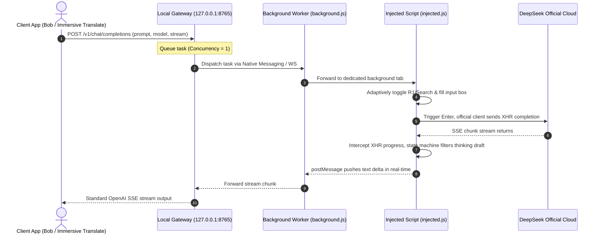

# DeepSeek Bridge (DeepSeek Web to API Bridge)

**English** | [简体中文](README_zh.md)

> Seamlessly bridge your logged-in DeepSeek Web session to a local, standard OpenAI-compatible API endpoint for Bob, Immersive Translate, Pot, Chatbox, and more.

[]()
[]()
[](LICENSE)

---

## 🌟 Highlights

- **100% Real Browser Context**: Reuses authenticated browser cookies, TLS fingerprints, and official WASM PoW challenge signatures. No reverse engineering, zero ban risk.
- **Dedicated Background Isolation**: Automatically maintains an isolated background instance (`_bridge=dedicated`), never interrupting your daily chats.
- **Low-Latency Streaming**: Intercepts native XHR `progress` events for instant, word-by-word Server-Sent Events (SSE) streaming (`stream: true`).
- **Serial Guard Queue**: Built-in `Concurrency = 1` task scheduler with cool-down pauses to prevent input box race conditions.
- **Visual Control Panel**: Comes with a clean Chrome Extension popup UI and an interactive web playground (`http://127.0.0.1:8765/`).

---

## 🚀 Quick Start

### 1. End Users (3 Steps, Zero Command Line)

Extract the portable release archive `deepseek-bridge-v0.2.1-portable.zip`:

```
Extracted Package (deepseek-bridge-v0.2.1-portable)
  ├── 1. Open Chrome at chrome://extensions/, enable [Developer mode], click [Load unpacked], and select the chrome-extension directory
  ├── 2. Double-click to register the host service:
  │      • macOS: Double-click install.command (shows system confirmation dialog)
  │      • Windows: Double-click install.bat
  └── 3. Log in to https://chat.deepseek.com/, open the extension popup and click [Start Service]
         👉 Once ready, set your client endpoint to http://127.0.0.1:8765/v1/chat/completions!
```

### 2. Client Configuration

Configure any OpenAI-compatible tool (e.g., **Immersive Translate**, **Bob**, **Pot**, **Chatbox**):

| Setting | Value | Description |
| :--- | :--- | :--- |
| **Provider Type** | `OpenAI` / `Custom OpenAI` | Standard OpenAI format |
| **API Endpoint (URL)** | `http://127.0.0.1:8765/v1/chat/completions` | Or base URL: `http://127.0.0.1:8765/v1` |
| **API Key** | Any string (e.g. `sk-deepseek`) | No strict key validation locally |
| **Model** | `deepseek-chat` or `deepseek-reasoner` | See toggle behaviors below |
| **Concurrency** | `1` | Recommended to pair with the serial queue |

> [!TIP]
> **Usage Scope**: Designed for personal, interactive desktop use (low-frequency, high-quality). Not intended for multi-user sharing or high-concurrency automated batch scraping.

---

## 🎛 Model & Feature Toggles

The bridge automatically adjusts DeepSeek's on-page switches (**Deep Think (R1)** and **Web Search**) according to the requested model name or payload parameters:

| Model / Parameter | Deep Think (R1) | Web Search | Recommended For |
| :--- | :---: | :---: | :--- |
| `deepseek-chat` (default) | ❌ Off | ✅ On | Quick translation, daily Q&A (ultra-fast) |
| `deepseek-reasoner` (or contains `r1`) | ✅ On | ✅ On | Academic polishing, formal document drafting, complex reasoning |

You can also explicitly pass parameters in the request body:
```json
{
  "model": "deepseek-chat",
  "thinking": true,   // Explicitly toggle Deep Think (R1)
  "search": true,     // Explicitly toggle Web Search (enabled by default)
  "stream": true,
  "messages": [{"role": "user", "content": "Please polish this abstract: ..."}]
}
```

---

## 🏗 Architecture

Built on a **Browser-in-the-Loop** architecture where the local service and Chrome MV3 extension collaborate:



---

## 📦 Build & Release Packaging

Run the automated packager from the repository root:

```bash
npm run package
# or: pnpm package
```

The script outputs clean distribution artifacts under `dist/`:

| Artifact | Size | Target Scenario | Key Highlights |
| :--- | :---: | :--- | :--- |
| **`dist/deepseek-bridge-v0.2.1-portable.zip`**<br>*(Recommended)* | **1.09 MB** | General distribution (GitHub Releases, cloud drives, sharing) | • **No `npm install` needed**: Pre-packaged 4MB production dependencies.<br>• **No CLI required**: Includes macOS `install.command` and Windows `install.bat`.<br>• **Deterministic ID**: Fixed extension key ensures consistent Extension ID across machines. |
| **`dist/deepseek-extension-v0.2.1.zip`** | **39.45 KB** | Extension-only distribution | Standalone Chrome extension package for existing users. |
| **`dist/deepseek-bridge-v0.2.1-portable/`** | Directory | Unpacked testing directory | Complete ready-to-test folder structure. |

---

## 💻 Developer Guide

### Start Locally
```bash
npm start
# Listens on http://127.0.0.1:8765 by default (override with PORT=xxxx)
```

### Run Automated Tests
Includes end-to-end API suites and Native Messaging protocol verification:
```bash
npm test
```

---

## ❓ FAQ

1. **Getting HTTP 503 error (Chrome extension not connected)**:
   - Ensure the Chrome extension service is running (green `[Running]` indicator in the popup).
   - Ensure you are logged in at `https://chat.deepseek.com`.
2. **Why is concurrency recommended to be 1?**:
   - The web interface shares a single input box. Concurrent requests can cause message overlapping. The gateway includes a built-in serial queue to handle requests smoothly.
3. **How do I access the visual playground?**:
   - Once the service is running, open `http://127.0.0.1:8765/` in your browser, or click `[🎮 Playground]` in the extension popup.

---

## ⚠️ Disclaimer

> [!CAUTION]
> **Please read and agree to this disclaimer before using this project.**

1. **For Educational & Research Purposes Only**: This project (`deepseek-bridge`) is intended solely for academic research on networking protocols, browser automation experiments, and personal technical exploration. Commercial use, bulk exploitation, and abusive traffic generation are strictly prohibited.
2. **Non-Affiliation**: This is an independent open-source experiment and is not affiliated with, endorsed by, or associated with DeepSeek (Hangzhou DeepSeek Artificial Intelligence Basic Technology Research Co., Ltd.). All DeepSeek trademarks, logos, and services remain the property of their respective owners.
3. **Fair Use & Rate Limiting**: Users must adhere to DeepSeek's Terms of Service and applicable laws. This project enforces a serial task queue and cool-down intervals to mimic normal human interaction. Do not alter parameters to conduct malicious or excessive traffic generation.
4. **Assumption of Risk**: The user assumes all risks associated with using this software (including, but not limited to, account limitations, anti-bot challenges, or temporary blocks). The authors and maintainers accept no liability for any direct or consequential damages.
5. **Takedown & Intellectual Property**: If you are a rights holder and believe any part of this project infringes upon your rights, please open an Issue and we will promptly evaluate and cooperate.
