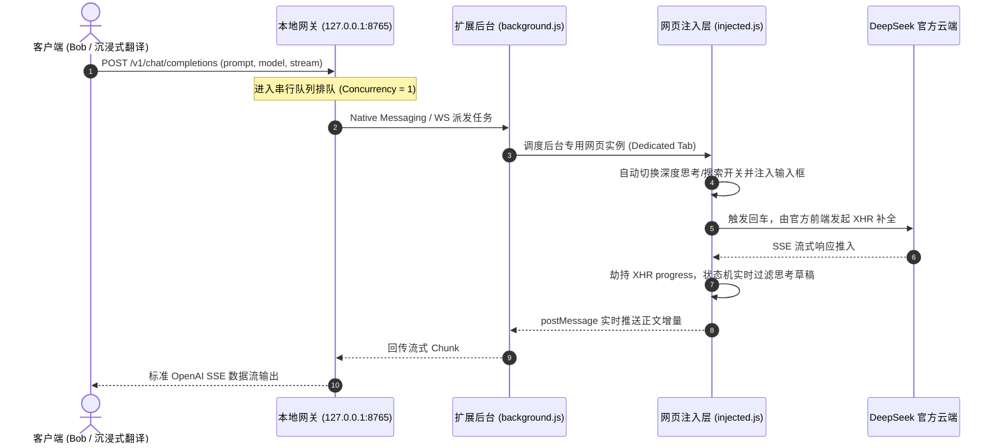

# DeepSeek 桥接网关 (DeepSeek Web to API Bridge)

[English](README.md) | **简体中文**

> 将已登录的 DeepSeek 网页端无感桥接为本地标准 OpenAI 兼容接口，供 Bob、沉浸式翻译、Pot、Chatbox 等客户端直接调用。

[]()
[]()
[](LICENSE)

---

## 🌟 核心特性

- **100% 真实环境**：复用真实浏览器指纹、Cookie 会话与官方 WASM PoW 签名，免逆向、免风控。
- **独立后台隔离**：自动在后台静默运行专用实例（`_bridge=dedicated`），彻底隔离用户日常聊天。
- **双向流式透传**：底层劫持 XHR progress 事件截获数据流，毫秒级推送标准 SSE 打字机流（`stream: true`）。
- **串行安全队列**：内置 `Concurrency = 1` 调度队列与防冲垮间隔，杜绝并发导致网页输入冲突。
- **可视化控制台**：自带 Chrome 扩展控制面板与 Web 交互式对话调试台（`http://127.0.0.1:8765/`）。

---

## 🚀 极速上手 (Quick Start)

### 1. 终端用户（3 步开箱即用，零命令行）

从发布包解压 `deepseek-bridge-v0.2.1-portable.zip` 后：

```
解压便携包 (deepseek-bridge-v0.2.1-portable)
  ├── 1. 打开 Chrome 访问 chrome://extensions/ 开启【开发者模式】，点击【加载已解压的扩展程序】，选择 chrome-extension 目录
  ├── 2. 双击注册服务：
  │      • macOS 用户：双击 install.command（系统弹窗提示注册成功）
  │      • Windows 用户：双击 install.bat
  └── 3. 浏览器登录 https://chat.deepseek.com/，点击右上角插件面板【启动服务】
         👉 服务就绪后，直接在客户端中填入 http://127.0.0.1:8765/v1/chat/completions 即可使用！
```

### 2. 客户端接入配置

在任意支持 OpenAI 格式的工具（以 **沉浸式翻译** 为例）中配置：

| 配置项 | 填写内容 | 说明 |
| :--- | :--- | :--- |
| **服务商类型** | `OpenAI` / `自定义 OpenAI` | 标准 OpenAI 兼容接口 |
| **API 接口地址 (URL)** | `http://127.0.0.1:8765/v1/chat/completions` | 部分工具仅需填基础地址 `http://127.0.0.1:8765/v1` |
| **API Key** | 任意字符（如 `sk-deepseek`） | 本地网关不强制校验 Key |
| **模型名称 (Model)** | `deepseek-chat` 或 `deepseek-reasoner` | 详见下方模型与参数控制 |
| **推荐并发数** | `1` | 配合服务端串行保护队列体验最佳 |

> [!TIP]
> **使用边界提示**：本项目适合个人日常桌面低频高质交互；不适合团队多人共用单个网关，或大规模高并发批量爬取。

---

## 🎛 模型与参数控制

网关根据**模型名称**或**请求参数**自适应调节网页端的“深度思考”与“智能搜索”开关，无需手动去网页点击：

| 模型 / 参数 | 深度思考 (R1) | 智能搜索 | 适用场景 |
| :--- | :---: | :---: | :--- |
| `deepseek-chat`（默认） | ❌ 关闭 | ✅ 开启 | 即时划词翻译、日常问答（极速响应） |
| `deepseek-reasoner`（或包含 `r1`） | ✅ 开启 | ✅ 开启 | 长文润色、学术重构、复杂逻辑推演 |

支持在请求 Body 中显式控制：
```json
{
  "model": "deepseek-chat",
  "thinking": true,   // 显式开启/关闭深度思考 (R1)
  "search": true,     // 显式开启/关闭联网搜索 (默认开启)
  "stream": true,
  "messages": [{"role": "user", "content": "请对以下段落进行专业翻译润色：..."}]
}
```

---

## 🏗 系统架构

系统基于“借壳代理 (Browser-in-the-Loop)”架构，由本地服务与 Chrome MV3 扩展协同中继：



---

## 📦 打包与分发部署

在项目根目录运行一键打包命令：

```bash
npm run package
# 或使用 pnpm package
```

构建脚本自动在 `dist/` 目录下生成标准分发产物：

| 产物文件 | 体积 | 适用分发场景 | 核心优势 |
| :--- | :---: | :--- | :--- |
| **`dist/deepseek-bridge-v0.2.1-portable.zip`**<br>*(推荐主力分发)* | **1.09 MB** | **向所有终端用户推广分发**（网盘分享、Release、邮件传发） | • **免 npm install**：已预置 4MB 极简生产依赖，解压即用。<br>• **免命令行**：内置 Mac `install.command` 与 Win `install.bat` 双击一键安装脚本。<br>• **ID 严格固定**：内置固定公钥 Key，不同电脑加载后扩展 ID 绝对一致，与 Native Host 完美绑定。 |
| **`dist/deepseek-extension-v0.2.1.zip`** | **39.45 KB** | **纯 Chrome 插件独立更新场景** | 仅包含轻量浏览器扩展核心文件，供老用户单独更新插件。 |
| **`dist/deepseek-bridge-v0.2.1-portable/`** | 目录 | 本地免解压直接测试/归档目录 | 包含完整的未压缩绿色结构及《快速安装使用指南.txt》。 |

---

## 💻 开发者指南

### 本地启动开发
```bash
npm start
# 默认监听 http://127.0.0.1:8765，可通过 PORT=xxxx 修改端口
```

### 自动化测试
内置高保真端到端接口测试与 Native Messaging 二进制协议套件：
```bash
npm test
```

---

## ❓ 常见问题 (FAQ)

1. **接口返回 503 错误（Chrome 扩展未连接）**：
   - 确认 Chrome 扩展面板中的【启动服务】已开启（状态指示灯为绿色【运行中】）。
   - 确认 `https://chat.deepseek.com` 处于已登录状态。
2. **为什么客户端并发数建议设为 1？**：
   - 网页端共用同一输入框，并发请求会导致文本冲突。服务端内置串行队列已做排队调度，客户端设为 1 体验最流畅。
3. **如何访问可视化调试工作台？**：
   - 服务启动后，浏览器直接打开 `http://127.0.0.1:8765/`，或在扩展弹窗中点击【🎮 对话调试台】。

---

## ⚠️ 免责声明 (Disclaimer)

> [!CAUTION]
> **请在阅读并同意本免责声明后再使用本项目。**

1. **仅供学习与学术研究**：本项目（`deepseek-bridge`）仅供计算机网络技术研究、浏览器自动化交互实验及个人开发学习交流使用，严禁用于任何商业牟利、批量刷量或恶意滥用行为。
2. **非官方从属声明**：本项目属于个人独立开源实验，与 DeepSeek（杭州深度求索人工智能基础技术研究有限公司）官方不存在任何关联、从属或商业合作关系。DeepSeek 及其相关商标、LOGO 和服务的所有权归其官方所有。
3. **合规使用与风控倡议**：请使用者严格遵守 DeepSeek 官方的《用户服务协议》与相关法律法规。本项目内置了单并发串行排队与冷却保护间隔，旨在模拟正常人类低频交互，请勿擅自修改参数发起高并发请求，严禁对官方服务器造成恶意的流量负担。
4. **风险自负原则**：使用者须自行承担由于使用本工具可能引发的任何技术风险、法律责任或平台风控限制（包括但不限于验证码拦截、账号受限或封号等）。项目作者与维护者不对任何直接或间接后果承担连带保证责任。
5. **权利人保护通道**：若官方或相关权利人认为本项目的代码或文档存在侵权或不妥之处，请提交 Issue，我们将第一时间积极配合评估、修改或下线相关内容。

