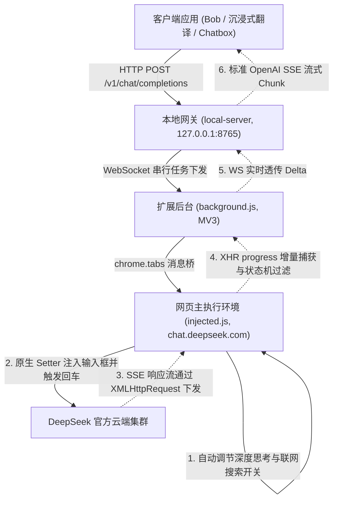

# DeepSeek 网页端转本地 OpenAI 兼容 API 产品需求文档 (PRD)

## 1. 产品概述
本项目旨在为桌面本地翻译及办公工具（如沉浸式翻译、Bob、Pot、Chatbox、NextChat 等）提供免费、稳定、高精度的 DeepSeek 大模型推理中继。通过“本地代理服务端 + 浏览器扩展”协同架构，将已登录的 DeepSeek 网页端代理为标准 OpenAI 格式 HTTP 接口，复用真实浏览器指纹与原生 WASM PoW（工作量证明）签名。

## 2. 目标用户与应用场景
- **目标用户**：使用沉浸式翻译插件、Bob、Pot、OpenCat、Chatbox 等支持配置自定义 OpenAI 兼容接口的用户。
- **典型场景**：
  - 网页划词即时翻译与整页双语沉浸式翻译。
  - 学术论文、商务公文的高水平逻辑润色与重构。
  - 结合全网实时数据的资讯查询与问答。
  - 桌面客户端无缝接入 DeepSeek 模型。

## 3. 系统架构与交互原理

## 4. 功能规范与版本演进

### 4.1 V0.1 版本功能规范（当前基线版）
- **本地网关接口**：
  - 默认监听地址：`http://127.0.0.1:8765`。
  - 模型列表 `GET /v1/models`：同时提供 `deepseek-chat`（V3极速模式）与 `deepseek-reasoner`（R1深度思考模式）。
  - 对话补全 `POST /v1/chat/completions`：
    - 全面兼容 OpenAI 入参（`messages`, `stream`, `model`, `thinking`, `search` 等）。
    - 支持非流式返回（`stream: false`，返回完整 JSON 响应）。
    - 支持流式返回（`stream: true`，以 `text/event-stream` 格式持续推送 delta 增量）。
- **任务并发与超时控制**：
  - 串行队列控制（`Concurrency = 1`），请求间保持 300ms 动态冷却隔离。
  - 默认超时放宽至 180s（3分钟），支持环境变量 `REQUEST_TIMEOUT` 配置。
- **动态功能控制与自适应**：
  - **联网搜索（智能搜索）**：默认始终开启（`search: true`）。
  - **深度思考 (R1)**：根据 `model`（包含 `reasoner`/`r1` 则开启）或 `thinking` 参数自动调节页面底部开关。
- **底层通信与流式拦截**：
  - 突破 XHR 拦截：重写 `XMLHttpRequest.prototype`，监听 `progress` 事件增量切片。
  - 状态机过滤：识别 `type: "THINK"` 与 `type: "RESPONSE"`，静默消化推演过程，输出 100% 纯净正文。
  - 双重兜底：支持 XHR + Fetch 旁路监听 + DOM 节点文本兜底提取。

### 4.2 V0.2 版本功能规范（极简一键化落地态）
- **特性 1：Chrome 扩展控制面板（Popup UI）**
  - 工具栏直观面板，具备【启动/停止代理服务】大开关、8765 端口运行状态指示灯、DeepSeek 网页就绪指示灯。
  - 实时滚动调试日志终端，支持一键清空日志与一键复制 API 地址。
- **特性 2：Chrome Native Messaging 零终端静默拉起**
  - 基于 Chrome 官方标准 Native Messaging 规范，点击【启动服务】时由浏览器核心自动在后台静默拉起本地微型网关，点击【停止服务】或关闭 Chrome 时自动安全回收并释放 8765 端口，全流程零命令行终端、零黑窗口。
- **特性 3：双击免配置安装器（OS 原生一键部署）**
  - 提供 macOS 双击执行的 `install.command` 与 Windows 双击执行的 `install.bat`，3 秒内完成系统 `NativeMessagingHosts` 注册，并弹出系统原生弹窗提示完成。
- **特性 4：网页生命周期全自动托管**
  - 启动时自动检索 `chat.deepseek.com` 标签页，若未打开则自动在后台静默创建并固定（Pinned Tab），普通用户无需手动打开或维护网页标签。
- **特性 5：固定公钥与确定性扩展 ID**
  - 预设固定 Extension Key，跨系统任何路径加载均恒定生成相同 Extension ID，杜绝原生通道权限配置错位。
- **特性 6：一键便携式绿色打包（Portable Release）**
  - 支持 `npm run package` 自动化构建，产出仅 1.09MB 的绿色分发包（`deepseek-bridge-v0.2.0-portable.zip`），内置精简生产依赖、双端双击安装脚本与快速指南，普通用户零命令、免 `npm install` 即解即用。
- **特性 7：交互式对话调试工作台（Web Playground）**
  - 内置于本地网关 `http://127.0.0.1:8765/`，支持在线对话测试、模型即时切换与实时 SSE 数据包原始日志监控。
  - 快捷预设测试用例专区提供 **cURL 终端命令行调用** 卡片与【一键复制】功能，自动联动当前选择的模型与流式开关，一键即可直接在终端粘贴执行。

### 4.3 后续演进规划（V0.3+ 路线图）
- **思考链透明流式透传**：支持通过 `include_reasoning: true` 将 R1 思考过程以 `reasoning_content` 同步流式推送。
- **多标签页并发调度池**：后台维护 2~3 个活动页面，实现 `Concurrency > 1` 并行吞吐。
- **真实 Token 统计与流速计量**：提取实际消耗的 Token 与 TPS 指标并回传。

## 5. 非功能性需求
- **安全性**：网关仅绑定 `127.0.0.1` 本地回环地址，不暴露公网。
- **稳定性**：MV3 Alarms 心跳保活，防止扩展后台休眠。
- **低延迟**：XHR 流式增量毫秒级透传，无额外格式转换阻塞。
- **可靠性**：提供完备的端到端自动化测试套件与浏览器真机自测能力。
